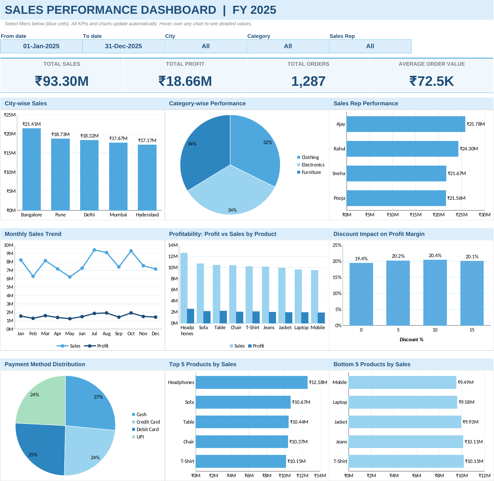

# Sales Performance Dashboard | FY 2025 (Excel)

An interactive, formula-driven **Excel dashboard** built on 1,287 sales orders (Jan–Dec 2025). Change any filter and every KPI and chart updates instantly. No macros, no VBA.

## Dashboard Preview

## Features

**KPI cards:** Total Sales, Total Profit, Total Orders, Average Order Value

**Charts**
| Section | Chart |
|---|---|
| City-wise sales | Bar chart |
| Category-wise performance | Pie chart |
| Sales Rep performance | Bar chart |
| Monthly sales trend | Line chart (Sales & Profit) |
| Profitability analysis | Profit vs Sales by product (clustered column) |
| Discount impact on profit | Profit margin by discount % (bar chart) |
| Payment method distribution | Pie chart |
| Top 5 / Bottom 5 products | Bar charts (re-rank automatically with filters) |

**Filters (blue cells):** Date range (From / To), City, Category, Sales Rep. Use the drop-downs.

**Interactivity:** all charts are linked to the filters through `SUMIFS` / `COUNTIFS` / `INDEX-MATCH` formulas, and hovering over a chart shows detailed values.

## Workbook structure
| Sheet | Purpose |
|---|---|
| `Dashboard` | KPI cards, filters and 9 charts |
| `Sales_Data_2025` | Raw data (14 columns, 1,287 rows) |
| `Calc` | Helper tables that feed the charts (do not edit) |

## How to use
1. Download `Sales_Dashboard_2025.xlsx` and open it in Excel (2016 or later; Microsoft 365 recommended).
2. On the `Dashboard` sheet, pick values in the blue filter cells.
3. To use your own data, paste it into `Sales_Data_2025` with the same 14 columns. Extend the formula ranges if you add more rows.

## Dataset columns
`Order_ID, Order_Date, Customer_Name, City, Region, Product_Category, Product_Name, Sales_Rep, Units_Sold, Unit_Price, Total_Sales, Payment_Method, Discount_%, Profit`

## Files
- `Sales_Dashboard_2025.xlsx` – the dashboard
- `Sales_Dashboard_Animation.pptx` – animated walkthrough (raw data → dashboard)
- `Sales_Dashboard_Preview.gif`, `Dashboard_Screenshot.png` – previews

## Tools
Microsoft Excel (formulas, data validation, native charts), built with the help of Claude (Anthropic).
